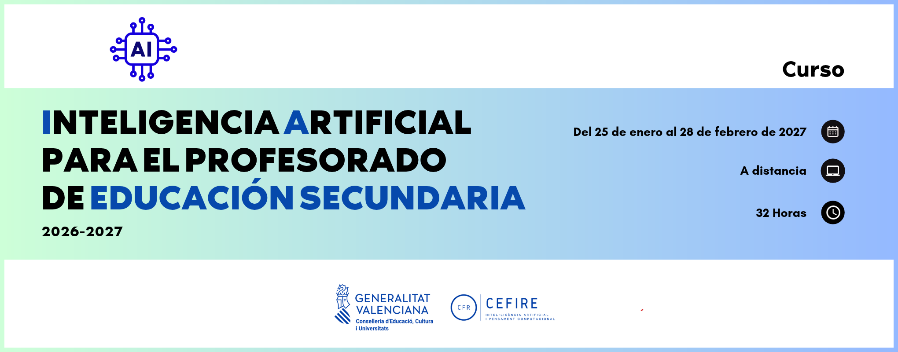

# IA para la ESO

## Objetivos

* Diseñar actividades y situaciones de aprendizaje mediante IA
* Crear instrumentos de evaluación
* Comprender cómo el alumnado puede utilizar la IA para realizar tareas académicas
* Utilizar la IA para corregir, analizar y mejorar procesos de evaluación

## Planificación

| Semana | Fecha | Tema | Responsable | Recursos |
|--------|-------|------|-------------|----------|
| 1 | 25/01/27 | Fluency IA | Manuel |   |
| 2 | 01/02/27 | Actividades | José Manuel + Manoli |  |
| 3 | 08/02/27 | Instrumentos de evaluación + Uso de la IA por parte del alumnado | Manoli  + Roble |   |
| 4 | 15/02/27 | Corrección y mejora. Actividad final | Aitor + Roble + Manuel |   |
| 5 | 22/02/27 | Entrega de tareas | |   |

Fecha límite de entrega de tareas - 26/02/27
Fecha límite de calificación del curso - 28/02/27