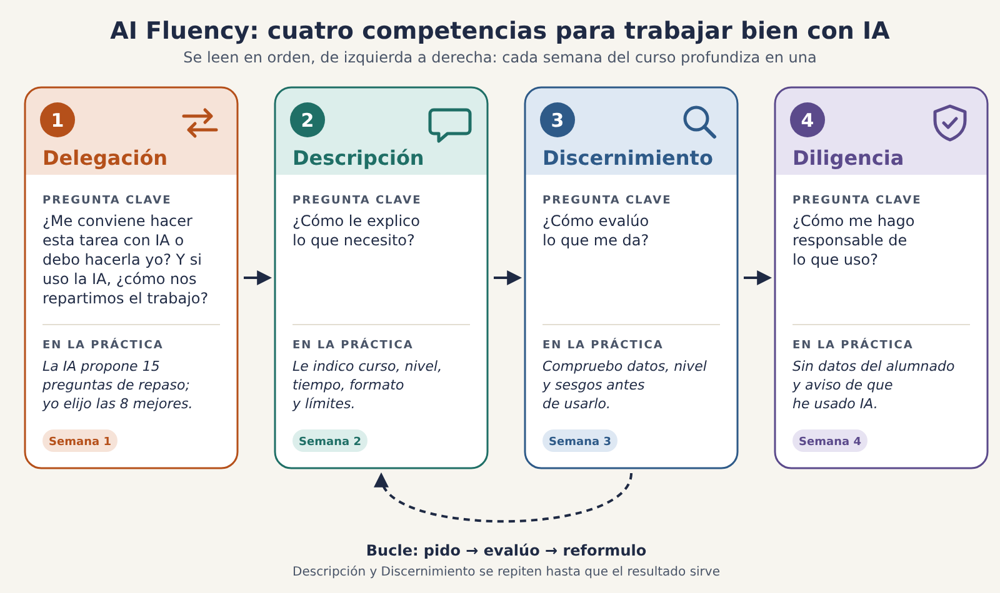

# Semana 1 · Apuntes · AI Fluency

Esta semana vamos a ver qué es de verdad un asistente de IA, qué son las 4D y por qué lo que le cuentas a la IA cambia tanto lo que te responde. Son unos 40 minutos de lectura.

## 1. Qué es un modelo de lenguaje

Piensa en el autocompletado del móvil. Un asistente de IA funciona igual, pero a lo grande. Haz la prueba con esta frase: *«Los alumnos salieron corriendo al patio porque había sonado el…»*. Seguro que has pensado «timbre». El modelo hace lo mismo: elige la palabra **más probable**, la añade y repite, palabra a palabra, hasta completar la respuesta.

**Que suene bien no significa que sea verdad.** El modelo busca la respuesta más probable, no la verdadera. Casi siempre coinciden, pero no siempre. Y cuando no sabe algo, no te dice «no lo sé»: te da algo que lo parece.

De aquí salen dos problemas que conviene distinguir:

| Problema | Qué es | Ejemplo |
| --- | --- | --- |
| Alucinación | Un dato falso que parece cierto | Una referencia bibliográfica, una cita o un criterio de evaluación inventados |
| Sesgo | Datos ciertos, pero desequilibrados | Diez científicos importantes, todos reales, casi todos hombres |

**Esto no les pasa solo a los despistados.** En 2025, un periódico de Chicago publicó una lista de lecturas de verano hecha con IA: 10 de los 15 libros no existían. En 2023, un abogado de Nueva York fue multado por presentar a un juez casos judiciales que se había inventado ChatGPT. ¿Cómo lo comprobó? Preguntándole a la propia IA si eran reales.

**Qué tienes que hacer tú:** comprobar siempre nombres, cifras, fechas y citas en la fuente original (si es normativa, en el DOGV o el BOE). Aunque el asistente busque en internet, puede equivocarse: abre los enlaces y mira que digan lo que él dice.

## 2. Las 4D

Las 4D son las cuatro competencias que necesitas para trabajar bien con IA. Son el hilo conductor del curso: cada semana nos centramos en una.

| D | Pregunta clave | Semana |
| --- | --- | --- |
| Delegación | ¿Me conviene hacer esta tarea con IA o debo hacerla yo? Y si uso la IA, ¿cómo nos repartimos el trabajo? | 1 |
| Descripción | ¿Cómo le explico lo que necesito? | 2 |
| Discernimiento | ¿Cómo evalúo lo que me da? | 3 |
| Diligencia | ¿Cómo me hago responsable de lo que uso? | 4 |

Descripción y Discernimiento van de la mano y forman un **bucle**: pides, revisas lo que te da y vuelves a pedir mejor. Lo normal es que la primera respuesta no sea la buena; en dos o tres vueltas, sin empezar de cero, suele quedar bien.

## 3. Delegación

Delegar bien empieza antes de abrir el asistente. Primero necesitas tener claras dos cosas:

- **Conciencia del problema** (*Problem Awareness*). Antes de meter a la IA por medio, ten claro qué quieres conseguir y cómo es el trabajo: para quién es, qué resultado esperas y qué partes necesitan tu criterio profesional. «Necesito una actividad de repaso de 15 minutos para 2.º de ESO que saque a la luz los errores más frecuentes» es un problema claro. «Hazme algo sobre el tema 3», no.
- **Conciencia de la plataforma** (*Platform Awareness*). Conoce qué sabe hacer y qué no el asistente que usas: si busca en internet, si puede leer tus archivos o crear imágenes, qué recuerda de otras conversaciones, hasta qué fecha llega su conocimiento y qué condiciones de privacidad y edad tiene. No todos sirven igual para todo.

Con esto claro, ya puedes delegar. La pregunta clave es: *«¿Me conviene hacer esta tarea con IA o debo hacerla yo? Y si uso la IA, ¿cómo nos repartimos el trabajo?»*. Para responderla, hazte dos preguntas:

1. **¿Puedo hacerlo con IA?** ¿Es posible? ¿Lo permite la normativa?
2. **¿Tiene sentido hacerlo con IA?** ¿De verdad me ahorra tiempo? ¿Pierdo criterio o el conocimiento que tengo de mi grupo?

Si las dos respuestas son «sí», adelante. Pero delegar no es olvidarse: este semáforo te ayuda a decidir cuánto tienes que revisar.

| Color | Qué significa | Ejemplos |
| --- | --- | --- |
| Verde | Delega y revisa | Ideas de actividades, borradores, ejemplos |
| Ámbar | Delega, pero revísalo todo a fondo | Resúmenes de normativa, rúbricas, soluciones de ejercicios |
| Rojo | No lo delegues | Calificar, decidir adaptaciones, informes sobre alumnado real |

**Hay decisiones que siempre son tuyas:** calificaciones, adaptaciones, orientación y disciplina. La IA te puede ayudar a preparar materiales, pero quien decide y responde eres tú.

## 4. Contexto, fuentes y memoria

Imagina que mañana entra un sustituto en tu clase. Sabe mucho, pero no conoce a tu grupo: solo sabe lo que tú le dejes encima de la mesa. Con la IA pasa lo mismo.

| Concepto | En el ejemplo del sustituto | En la IA |
| --- | --- | --- |
| Contexto | La nota que le dejas con indicaciones | Todo lo que tiene delante ahora: instrucciones, documentos y mensajes de la conversación. Tiene un límite: en conversaciones muy largas se le olvida el principio |
| Fuentes | Los documentos que le dejas para consultar | Los archivos que adjuntas, como un decreto o tu programación. Ayudan mucho, pero no garantizan que cite bien |
| Memoria | Lo que apunta en su libreta para la próxima vez | Lo que recuerda de una conversación a otra. Puedes revisarlo y borrarlo; el chat temporal o incógnito no guarda nada |

Un **proyecto** junta las tres cosas: unas instrucciones fijas, tus fuentes y su propia memoria. Así no tienes que explicar quién eres cada vez que abres un chat. Claude, ChatGPT y Le Chat de Mistral los llaman «Proyectos»; Gemini, «Gems»; Perplexity, «Espacios», y Copilot, «Notebooks». Cualquiera te sirve para el curso.

**Si te quedas con una sola idea del curso, que sea esta: el contexto condiciona la respuesta.** Si no le das contexto, la IA se inventa lo que le falta. Esta semana vas a crear tu proyecto «IA para docentes» con tu perfil, y cada semana le iremos añadiendo algo.

## 5. Precauciones básicas

- **Usa una cuenta personal (NO GVA)** para crear recursos sin datos personales. Y no repitas tu contraseña de la Conselleria.
- **Ni un solo dato personal real** de alumnado, familias o compañeros: ni en lo que escribes, ni en los archivos, ni en la memoria. Anonimizar no es solo quitar el nombre: el grupo, la edad o una situación familiar ya identifican. Si tienes dudas, inventa el caso.
- **Edad mínima.** Claude exige 18 años y cada servicio tiene la suya. Míralo antes de proponerle una herramienta a tu alumnado.

## Lo que te tienes que llevar de esta semana

1. **Que suene bien no significa que sea verdad:** la IA da lo más probable, no lo verdadero.
2. **Comprueba siempre** nombres, cifras, fechas, citas y enlaces en la fuente original.
3. **Delegar no es olvidarse:** hay decisiones que siempre son tuyas.
4. **El contexto lo cambia todo:** sin contexto, la IA se inventa lo que le falta.
5. **Ni un dato personal real.**
