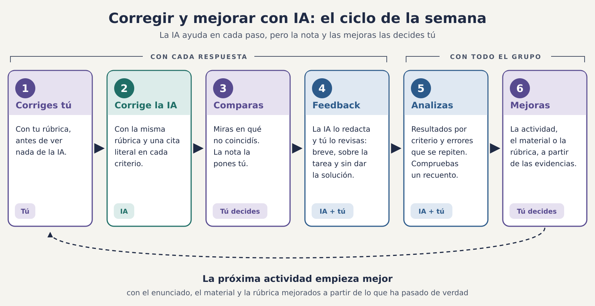
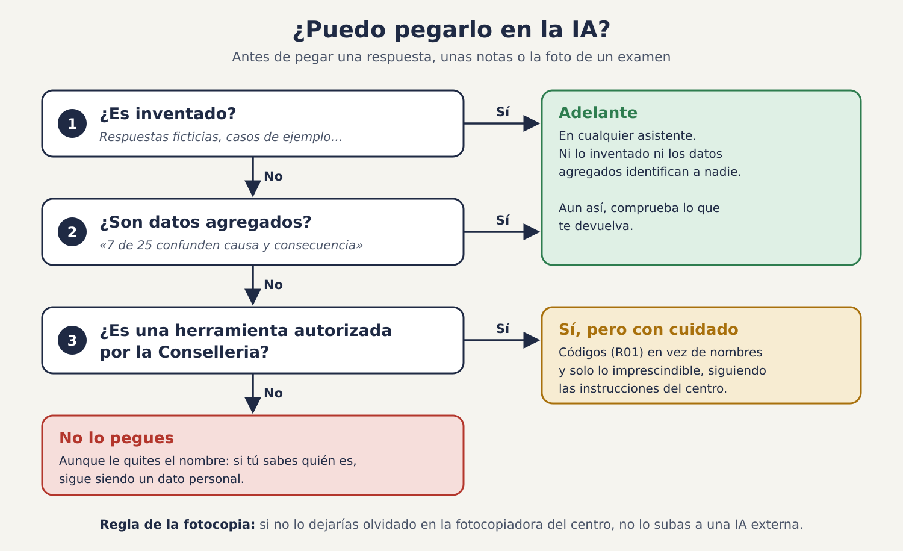

# Semana 4 · Apuntes · Corrección y mejora

Esta semana la IA te ayuda a corregir con tu rúbrica, a escribir el *feedback* y a mirar los resultados de todo el grupo para mejorar tus actividades. Es la semana de la **Diligencia**: puedes delegar parte del trabajo, pero la nota, las decisiones y los datos son responsabilidad tuya. Son unos 30 minutos de lectura.

## 1. Segundo corrector, no juez

En la semana 1 pusimos «calificar» en el rojo del semáforo, y ahí sigue. Lo que sí puedes hacer es usar la IA como **segundo corrector**: revisa contigo, te avisa de lo que se te ha escapado y te ayuda a redactar. Pero la nota la pones tú.

El orden importa: **primero corriges tú** con tu rúbrica, **después corrige la IA** con la misma rúbrica y **comparas** criterio a criterio. Y el ciclo no acaba en la nota: sigue con el *feedback*, el análisis del grupo y la mejora de tus materiales.

¿Por qué primero tú? Porque si ves antes la nota de la IA, te arrastra: es el **efecto ancla**. Si corriges tú primero, cada discrepancia te da información: unas veces se equivoca la IA, otras se te ha escapado algo a ti y otras el problema es que la rúbrica es ambigua.

## 2. ¿Corrige bien? Los fallos típicos

La IA corrige con mucha seguridad, también cuando se equivoca.

| Fallo | Qué pasa | Cómo lo pillas |
| --- | --- | --- |
| Se deja llevar por la forma | Más texto o mejor redactado, más nota, aunque diga menos | Comprueba el contenido, no la extensión ni la redacción |
| Mezcla criterios | Las faltas de ortografía también le bajan la nota de contenido | Mira si la nota de cada criterio se explica solo con ese criterio |
| Se inventa evidencias | Justifica la nota con algo que el alumno no ha escrito | Pídele la cita literal (vídeo 1) |
| No es constante | Si corrige dos veces la misma respuesta, da notas distintas | Repite la corrección en un chat nuevo |

**El truco de la semana es pedirle la prueba.** Exígele que, en cada criterio, copie entre comillas el fragmento de la respuesta que justifica la nota. Si no hay fragmento, no hay nota.

## 3. *Feedback* personalizado para todo el grupo

Escribir un comentario personalizado para cada uno de tus 25 alumnos es lo más pesado de corregir, y es donde la IA te ahorra más tiempo: puede redactar en unos segundos el *feedback* de todas las respuestas, cada uno adaptado a lo que ha escrito ese alumno. Un buen *feedback* formativo tiene tres partes:

1. **Una fortaleza concreta**, con un ejemplo sacado de su respuesta.
2. **Una mejora prioritaria**: solo una, la más importante.
3. **Un siguiente paso**, algo que pueda hacer ya en la próxima tarea.

Y tres reglas para que funcione: que sea **breve** (dos o tres frases), que hable de **la tarea y no de la persona** («tu explicación…», no «eres…») y que **no le dé la solución**. El siguiente paso le dice qué hacer, pero no se lo hace.

| *Feedback* genérico | *Feedback* que ayuda |
| --- | --- |
| «Buen trabajo, pero tienes que profundizar más.» | «Explicas bien las causas de la Revolución Industrial (segundo párrafo). Te falta relacionarlas con sus consecuencias. La próxima vez, une cada causa con una consecuencia usando "por eso…".» |

**Que sea automático no quiere decir que no lo revises.** Lee cada comentario antes de que le llegue al alumno: que hable de lo que ha escrito él y no de lo que la IA supone, que no se repitan las mismas frases de un alumno a otro y que el tono encaje con ese alumno. A él la IA no lo conoce; tú, sí.

## 4. Del alumno al grupo: errores recurrentes

Corregir una a una las respuestas te dice cómo va cada alumno. Mirarlas todas juntas te dice **cómo ha funcionado tu actividad**. En esto la IA es muy útil, porque encuentra en segundos lo que se repite en treinta respuestas. Pídele tres cosas:

1. **Resultados por criterio:** en qué criterios va bien el grupo y en cuáles flojea.
2. **Errores recurrentes:** cuáles se repiten, en cuántas respuestas aparecen y un ejemplo literal de cada uno.
3. **Posibles causas:** ¿el fallo es del alumnado o de la actividad? Puede ser un enunciado ambiguo, un ejemplo confuso en el material o un paso que no se ha explicado.

**Comprueba los recuentos.** Coge uno de los errores y cuéntalo tú. A veces la IA exagera un patrón o mete en el mismo saco errores que son distintos.

## 5. De las evidencias a la mejora

Con los errores recurrentes en la mano, cierras el ciclo: mejoras la actividad, el material o la rúbrica a partir de lo que ha pasado de verdad, no de lo que te imaginabas.

| Lo que ves en los resultados | Qué puedes mejorar |
| --- | --- |
| Muchos confunden dos conceptos | Añadir al material un ejemplo que los compare |
| Casi nadie llega al último apartado | Revisar el tiempo o dividir la actividad |
| Responden a algo distinto de lo que se pedía | Reescribir el enunciado |
| En un criterio, tus notas y las de la IA no coinciden casi nunca | Hacer más observable el descriptor de la rúbrica |
| Dos respuestas que tú ves distintas reciben el mismo nivel | El descriptor no distingue: reescríbelo |

**Para revisar tus propios materiales, pídele que no te elogie.** Si no se lo dices, la IA tiende a darte la razón. Pídele que haga de revisor crítico, que busque problemas y que proponga una corrección para cada uno. Después, la IA propone y tú decides qué cambias, porque eres quien conoce a tu grupo.

## 6. Protección de datos y anonimización

En el curso, trabaja **solo con respuestas ficticias**: las que generaste en la semana 3 o las que te inventes. En tu día a día, antes de pegar nada del alumnado, hazte estas tres preguntas:

**Anonimizar no es solo quitar el nombre.** Fíjate en este ejemplo:

| Original | Anonimizado a medias | Lo que necesitas para corregir |
| --- | --- | --- |
| «Soy Pau, de 2.º C. Como mi madre está de baja, he cuidado de mi hermana y no he acabado. Las causas fueron la máquina de vapor y el carbón…» | «Soy [alumno], de [grupo]. Como mi madre está de baja, he cuidado de mi hermana…» | «R01: Las causas fueron la máquina de vapor y el carbón…» |

La segunda columna sigue contando una situación familiar y de salud. Para corregir el contenido, solo necesitas la tercera.

**Tres buenas prácticas:**

1. **Pega solo lo que hace falta** para la tarea: la respuesta, no la lista de clase ni el contexto del alumno.
2. **Usa códigos** (R01, R02…) en vez de nombres, y guarda la tabla que relaciona cada código con su alumno fuera de la IA.
3. **Para pedir ideas de mejora, basta con datos agregados.** «7 de 25 confunden causa y consecuencia» no identifica a nadie, y es todo lo que la IA necesita para proponerte cambios en la actividad.

Además, el Reglamento europeo de IA considera de **alto riesgo** los sistemas que evalúan resultados de aprendizaje. Otra razón para que la última palabra sea siempre tuya, y para contarle a tu alumnado cómo usas la IA.

## 7. Tu proyecto crece: de perfil a asistente

Tu proyecto «IA para docentes» empezó en la semana 1 con tu perfil y ha ido creciendo. Esta semana le añades **tu rúbrica como fuente** y **tus instrucciones de corrección**. Y vas a aprender otra forma de escribir el contexto: **en vez de escribirlo tú, deja que la IA te entreviste.** Te hace preguntas de una en una, redacta las instrucciones, tú las revisas y las pegas (vídeo 2).

Al acabar el curso tendrás un contexto completo, tuyo, que te puedes llevar a cualquier asistente.

## Las 4D al corregir

| D | Al corregir con IA, pregúntate… |
| --- | --- |
| Delegación | ¿Qué le dejo (detectar errores, redactar *feedback*, buscar patrones) y qué me quedo yo (la nota, qué mejorar)? |
| Descripción | ¿Le he dado la rúbrica, el nivel y cómo quiero el *feedback*? |
| Discernimiento | ¿Cada nota tiene su cita real? ¿Los recuentos de errores son ciertos? |
| Diligencia | ¿Hay algún dato que permita identificar a alguien? ¿La última palabra es mía? |

## Lo que te tienes que llevar de esta semana

1. **Primero corriges tú, después la IA,** y la nota la pones tú.
2. **Pídele la prueba:** cada nota, con su cita literal.
3. ***Feedback* automático, pero revisado:** breve, sobre la tarea y sin darle la solución.
4. **Mira al grupo:** los errores que se repiten te dicen qué mejorar de tu actividad.
5. **Anonimizar no es quitar el nombre:** pega solo lo que haga falta, y nunca trabajos reales en una cuenta personal.